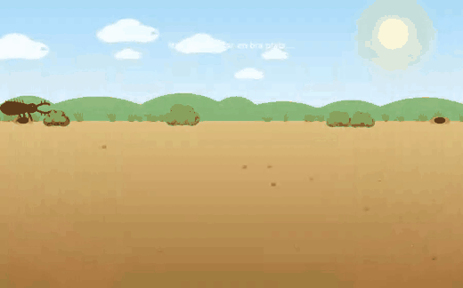
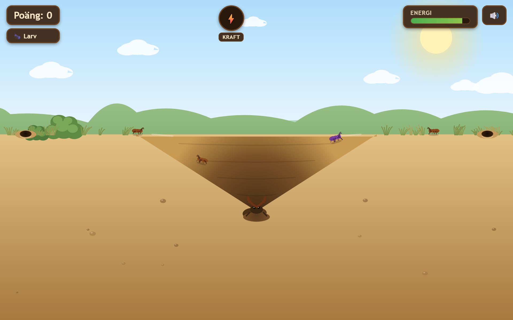

# 🐜🕳️ Ant Lion Attack

Spel där du är ett **myrlejon**. Det finns i två versioner: det klassiska 2D-arkadspelet och en ny isometrisk 3D-version.

**▶️ Startsida (välj version):** https://jhh-tech.github.io/ant-lion-attack/

| Version | Länk | Mapp |
|---|---|---|
| Klassisk 2D | https://jhh-tech.github.io/ant-lion-attack/2d/ | [`2d/`](2d/) |
| Ny 3D | https://jhh-tech.github.io/ant-lion-attack/3d/ | [`3d/`](3d/) |

## Klassisk 2D

Du ligger nedgrävd i botten av en sandgrop. Myror vandrar längs kanten — knuffa ner dem, kasta sand på dem så de glider mot botten, och ät dem för att överleva och växa dig större!



Fungerar i webbläsaren på både dator och mobil (mus eller touch). Går att lägga till på hemskärmen som en app.



### Hur man spelar (2D)

- **Myror** kryper fram ur bona vid skärmkanterna och vandrar mot gropen. Tryck/klicka nära gropens kant för att knuffa in en myra, och tryck på myror som redan fallit ner för att kasta sand på dem så de glider mot botten – där de fångas.
- **Energin** sjunker hela tiden. Fånga myror för att fylla på den. Tar energin slut är det game over.
- **Väx dig större** genom att samla poäng. Myrlejonet växer i sex steg (Larv → … → Jättemyrlejon), och gropen växer med i både bredd och djup. Större myrlejon kan äta större byten.
- **⚡ Kraftmätaren** fylls var 350:e poäng. När den är laddad – tryck på den för att skaka hela gropen och dra ner alla myror på en gång.
- **⚠ Stekeln** (gul med ränder) flyger in från sidan. Får den ner till botten sticker den dig – **undvik att trycka ner den!**
- **🌧 Regn:** ett moln seglar in och sedan regnar det en stund. Då blir sanden hård och myrorna ramlar inte ner förrän den torkat.

I inställningarna kan du justera antal myror på banan och deras storlek.

## 🆕 Ant Lion Attack 3D

En ny 3D-version i isometrisk vy (à la Diablo) finns i mappen [`3d/`](3d/).

**▶️ Spela här:** https://jhh-tech.github.io/ant-lion-attack/3d/

Här går du själv omkring som myrlejonet på en stor sandslätt:

- **Gå** genom att klicka/trycka på marken (håll in för att fortsätta gå) eller med `WASD`/piltangenterna.
- **Hugg** genom att klicka på ett kryp, högerklicka eller trycka `F`.
- **Gräv ner dig** med `Space`. Du gömmer dig för fiender och en grop växer fram runt dig. Myror och fiender som hamnar i gropen glider ner i dina käkar.
- **Bakhåll:** hugg nedifrån sanden eller kliv upp bredvid en fiende för dubbel eller trippel skada.
- **Sandskalv** (`Q`) när kraftmätaren är full.
- **Fiender** från lätta till svåra: soldatmyror, pansrade skalbaggar, hoppande vargspindlar, störtdykande steklar, fåglar (gräv ner dig när skuggan kommer!) och bönsyrsan som boss.
- **Kraftföremål:** honung, sockerbit, snabbfot, stålkäkar, djupgrop, pansar och feromon.
- Du växer i sex stadier, och nivån stiger var 45:e sekund.

### Installera som app (Android & dator)

3D-versionen är en installerbar webbapp (PWA). Den startar i helskärm med egen ikon och fungerar offline när den väl är installerad.

- **Android (Chrome):** öppna länken ovan och tryck på **📲 Installera** i startmenyn, eller välj ⋮ → *Installera app* / *Lägg till på startskärmen*.
- **Dator (Chrome/Edge på Windows, Mac, Linux):** klicka på **📲 Installera** i startmenyn eller på installera-ikonen i adressfältet. Spelet hamnar sedan i startmenyn/dockan som ett vanligt program.
- **iPhone/iPad (Safari):** Dela ⬆️ → *Lägg till på hemskärmen*.

3D-versionen använder [three.js](https://threejs.org/) (en lokal kopia ligger i `3d/vendor/`, MIT-licens). Alla modeller och ljud genereras i kod. Eftersom den använder ES-moduler måste den serveras över HTTP (t.ex. `python -m http.server`) och kan inte öppnas direkt som fil.

## Köra lokalt

Allt är statiskt – ingen byggprocess. Servera repots rotmapp med valfri statisk webbserver, t.ex.:

```bash
python -m http.server 8000
# öppna sedan http://localhost:8000/ (startsidan), /2d/ eller /3d/
```

## Teknik

- `index.html` i roten är en portalsida som länkar till båda versionerna.
- 2D: ren HTML + CSS + JavaScript, allt i en enda `2d/index.html`.
- 2D: rendering med Canvas 2D, ljud med Web Audio API (genereras i kod – inga ljudfiler).
- PWA-manifest (`2d/manifest.webmanifest`, `3d/manifest.webmanifest`) och ikoner för installation på hemskärmen.
- Poäng och inställningar sparas lokalt i webbläsaren (localStorage).

## Deploy

Alla filer är statiska, så det räcker att lägga hela repot (utom `.git`) i en katalog på valfri webbserver (helst över HTTPS). Det här repot publiceras automatiskt via GitHub Pages från `main`-branchen.
